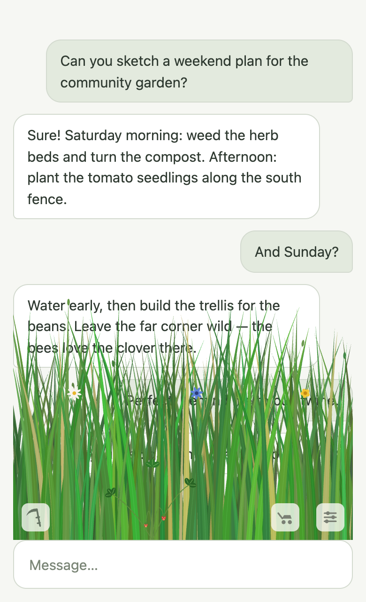

# Touch Grass for BB

[Русский](README.ru.md) · [Touch Grass on popkov.dev](https://popkov.dev/en/apps/touch-grass/) · [BB Market submission](https://github.com/get-bb/marketplace/pull/1034)

It's time to touch grass. A little meadow grows above the message box in each [BB](https://getbb.app) chat. Brush the grass to bend the blades, wake fireflies to grow flowers, or send a lawn mower across the whole strip.


## Play

| To… | Do this |
| --- | --- |
| Grow the meadow | In Compact and Tall, new inputs add height and density, up to 50 steps. In Overgrown, grass grows with elapsed time. |
| Grow a flower | Leave a new meadow open for about 15 seconds to see the first wildflower. Tap a firefly or brush across it once for another bloom. |
| Cut a path | Select the scythe on the left. Sweep near the tips for a trim, near the roots for a close cut, or diagonally to leave a slope. Pass through a flower’s head or stem to cut it. Tap the scythe again to put it away. |
| Mow the whole lawn | Press the mower on the right. It clears the grass, flowers and strawberry plants across the strip. Compact and Tall grow back in about a minute. |
| Choose the size and visitors | Tap the sliders on the right to turn the meadow over. Choose **Compact**, **Tall** or **Overgrown**, and allow bees, butterflies or both. Tap the same spot to flip back. On a keyboard, press **Esc**. |


With the scythe put away, swipe up or down over the grass to scroll the chat. Press a flower and sweep sideways to bend its stem along with the grass. They spring back when you let go.


Butterflies visit the grass. Once flowers bloom, bees can land on them. Wild strawberry plants sometimes take root between the flowers. Look for the low cluster of leaves with berries on their own stalks. After a cut, the meadow waits about two minutes before a new plant can grow. Compact mode keeps even a mature meadow just 38 px tall on desktop. Touch controls have room for a fingertip. The game also works with reduced motion.


**Overgrown** is the default for a new installation. In this mode, the grass grows over the messages to about one third of the visible chat. Tap the standing blades to press them down. Cut a path with the scythe and you can tap links through that opening. The mower clears the full width. The mower, bee and butterfly appear larger in this mode.

An Overgrown plot starts short. It reaches full height in **40 minutes of real time**, including time away from BB. Each thread remembers its own cut patches. Open the meadow settings to see the countdown. Drag the slider to choose a 20-, 40- or 60-minute growth period. Choose **Grow now** to fill this chat with tall grass immediately. Mowing starts the timer again.


## What shapes the grass?

| Signal from the current chat | What you see |
| --- | --- |
| Accepted inputs or recorded turn starts | Taller, denser grass in Compact and Tall. Old chats open at their existing growth. |
| Share of input tokens read from cache | More emerald blades at high cache reuse, more straw tones at low reuse. Providers that haven't reported usage yet get the base palette. |
| Tool calls among the last 24 started items | More bee visits when flowers are present. Activity reaches its maximum at 12 calls. |

In Compact and Tall, growth follows conversation steps. Five steps give about 29% of the journey from sprouts to mature grass, 20 give 67%, and 50 give 100%. Leaving the chat open keeps its grass at the same height. Each thread has its own blade pattern.

The plugin reads BB’s local event log. The server sends the meadow two numbers for cache and tool activity. Flowers are stored per thread in this BB client. Size, regrowth period and visitor preferences apply across chats on this device. Controls use English by default and Russian in a Russian-language BB document.

## Overgrown gallery

| Desktop · light | Desktop · dark |
| --- | --- |
| [](docs/media/overgrown-desktop.png) | [](docs/media/overgrown-desktop-dark.png) |

| On a phone | Holding a finger on the grass |
| --- | --- |
| [](docs/media/overgrown-mobile.png) | [](docs/media/overgrown-press.png) |


## Install

Use BB 0.50 or later and Node.js 22.15+ (22.x) or 24+.

```sh
git clone https://github.com/ai-babai/bb-plugin-touch-grass.git
cd bb-plugin-touch-grass
npm ci
bb plugin build
bb plugin install .
```

Open a chat with a visible composer. After editing, run `npm run build` and `bb plugin reload touch-grass`.

## Development

Run the checks before pushing:

```sh
npm run quality
```

The browser tests use Chrome on macOS. On Linux install Chromium with `npx playwright-core install chromium` or set `CHROME_PATH`. The suite exercises the UI in a browser with simulated BB events. It does not need access to a BB account.

The quality gate checks TypeScript, function complexity, dependency cycles, coverage of changed executable lines, CRAP scores, property-based tests and selected mutations. Its default comparison is the original meadow. To review a different change, pass a baseline, for example `npm run quality -- --base origin/main`. Details and thresholds are in the [quality guide](docs/quality.md).

## Original meadow

The original firefly game is preserved on [`archive/fireflies-v1`](https://github.com/ai-babai/bb-plugin-touch-grass/tree/archive/fireflies-v1) at `388d564`. From a clean checkout, switch the installed plugin back with:

```sh
git switch archive/fireflies-v1
npm ci
bb plugin build
bb plugin reload touch-grass
```

Use `git switch main` and repeat the last three commands to return. Both versions read the same saved flower garden.
