# Touch Grass for BB

[Русский](README.ru.md) · [Touch Grass on popkov.dev](https://popkov.dev/en/apps/touch-grass/) · [BB Market submission](https://github.com/get-bb/marketplace/pull/1034)

It's time to touch grass. A little meadow grows above the message box in each [BB](https://getbb.app) chat. Brush the grass to bend the blades, wake fireflies to grow flowers, or send a lawn mower across the whole strip.

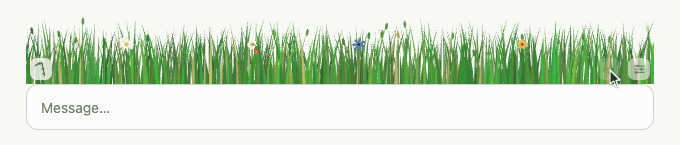

## Play

| To… | Do this |
| --- | --- |
| Grow the meadow | Grass grows with elapsed time in all three sizes. Switching sizes keeps the same growth and cuts. |
| Grow a flower | The first sprout appears after about 15 seconds. Tap a firefly or brush across it for another. Each stem grows for about ten minutes, lifting its bud into view. |
| Cut a path | Select the scythe on the left. Sweep near the tips for a trim, near the roots for a close cut, or diagonally to leave a slope. Sweep through a flower to cut it. A pass above a shorter plant trims the grass around it. Tap the scythe again to put it away. |
| Mow the whole lawn | Press the mower on the right. It clears the grass, flowers and strawberry plants across the strip. The grass then grows back over the period set in the meadow settings. |
| Choose the size and visitors | Tap the sliders on the right to turn the meadow over. Choose **Compact**, **Tall** or **Overgrown**, and allow bees, butterflies or both. Tap the same spot to flip back. On a keyboard, press **Esc**. |

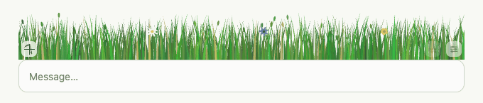

Some flowers grow in small clumps. A yellow dandelion ripens into a white seed head. Brush it back and forth to send a few seeds drifting.

With the scythe put away, swipe up or down over the grass to scroll the chat. Press a flower and sweep sideways to bend its stem along with the grass. They spring back when you let go.

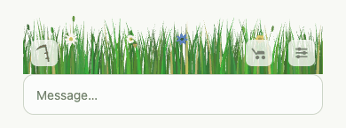

<picture>
  <source media="(prefers-color-scheme: dark)" srcset="docs/media/wildflowers-dark.png">
  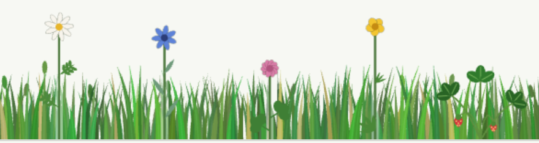
</picture>

Grass blades cross in front of the leaves. The mature flower heads rise to different heights along the top of the meadow. A bee landing on a flower slips behind the same blades.


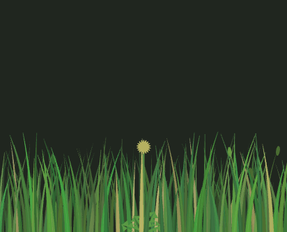

Butterflies visit the grass. Bees wait for open petals. A closed bud or a white dandelion seed head is left to ripen undisturbed. Wild strawberry plants sometimes take root between the flowers. Look for the low cluster of leaves with berries on their own stalks. After a cut, the meadow waits about two minutes before a new plant can grow. Compact mode keeps even a mature meadow just 38 px tall on desktop. Touch controls have room for a fingertip. The game also works with reduced motion.

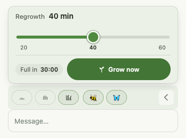

**Overgrown** is the default for a new installation. In this mode, the grass grows over the messages to about one third of the visible chat. Tap the standing blades to press them down. Cut a path with the scythe and you can tap links through that opening. The mower clears the full width. The mower, bee and butterfly appear larger in this mode.

Every meadow starts short. It reaches full height in **40 minutes of real time**, including time away from BB. Each thread remembers its own cut patches. Open settings in any size to see the countdown above the size controls. Choose any whole minute from 5 to 90. The slider marks 5, 15, 40 and 90 minutes, giving shorter periods more room for fine adjustments. Choose **Grow now** to bring the grass to full height in the selected size. Mowing starts the timer again.

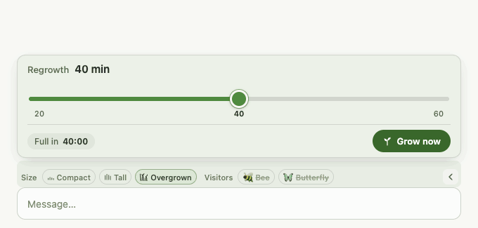

## What shapes the grass?

| Signal from the current chat | What you see |
| --- | --- |
| Elapsed time since mowing | Grass grows back over the selected period in all three sizes. |
| Conversation steps | The flower bed expands from 3 places to 12 over the first 50 steps. |
| Share of input tokens read from cache | More emerald blades at high cache reuse, more straw tones at low reuse. Providers that haven't reported usage yet get the base palette. |
| Tool calls among the last 24 started items | More bee visits when flowers are present. Activity reaches its maximum at 12 calls. |

Each thread has its own blade pattern. At the default 40-minute setting, a freshly mown meadow is halfway back to full height after 20 minutes in any size.

The plugin reads BB’s local event log. The server sends the meadow two numbers for cache and tool activity. Flowers are stored per thread in this BB client. Size, regrowth period and visitor preferences apply across chats on this device. Controls use English by default and Russian in a Russian-language BB document.

## Overgrown gallery

| Desktop · light | Desktop · dark |
| --- | --- |
| [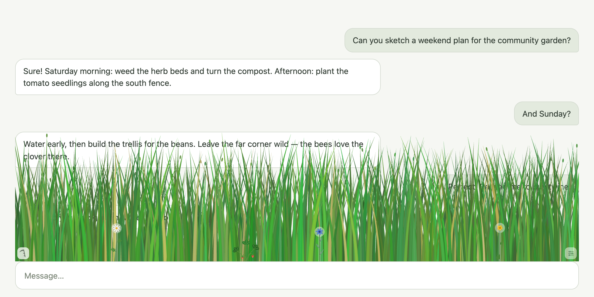](docs/media/overgrown-desktop.png) | [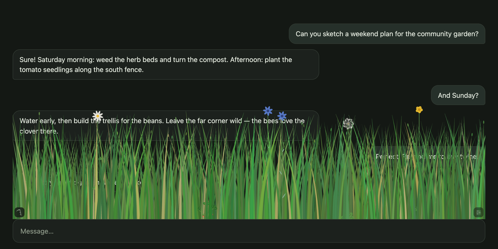](docs/media/overgrown-desktop-dark.png) |

| On a phone | Holding a finger on the grass |
| --- | --- |
| [](docs/media/overgrown-mobile.png) | [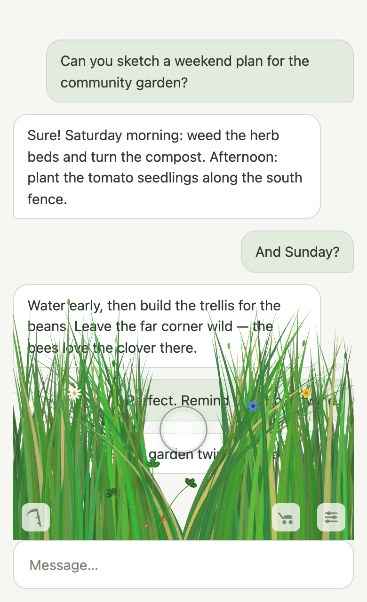](docs/media/overgrown-press.png) |

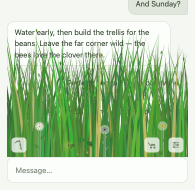

## Install

Use BB 0.50 or later and Node.js 22.15+ (22.x) or 24+.

```sh
git clone https://github.com/ai-babai/bb-plugin-touch-grass.git
cd bb-plugin-touch-grass
npm ci
bb plugin build
bb plugin install .
```

Open a chat with a visible composer. After editing, run `npm run build` and `bb plugin reload touch-grass`.

## Development

Run the checks before pushing:

```sh
npm run quality
```

The browser tests use Chrome on macOS. On Linux install Chromium with `npx playwright-core install chromium` or set `CHROME_PATH`. The suite exercises the UI in a browser with simulated BB events. It does not need access to a BB account.

The quality gate checks TypeScript, function complexity, dependency cycles, coverage of changed executable lines, CRAP scores, property-based tests and selected mutations. Its default comparison is the original meadow. To review a different change, pass a baseline, for example `npm run quality -- --base origin/main`. Details and thresholds are in the [quality guide](docs/quality.md).

## Original meadow

The original firefly game is preserved on [`archive/fireflies-v1`](https://github.com/ai-babai/bb-plugin-touch-grass/tree/archive/fireflies-v1) at `388d564`. From a clean checkout, switch the installed plugin back with:

```sh
git switch archive/fireflies-v1
npm ci
bb plugin build
bb plugin reload touch-grass
```

Use `git switch main` and repeat the last three commands to return. Both versions read the same saved flower garden.
