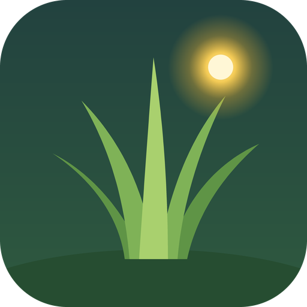
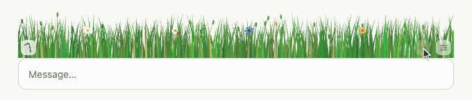
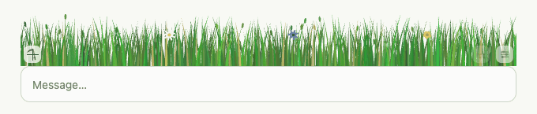
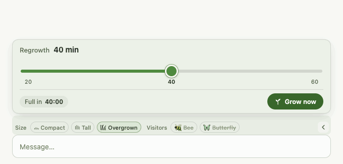
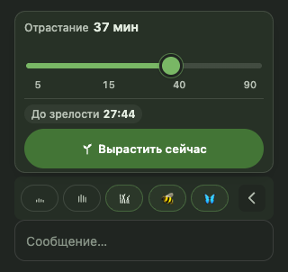
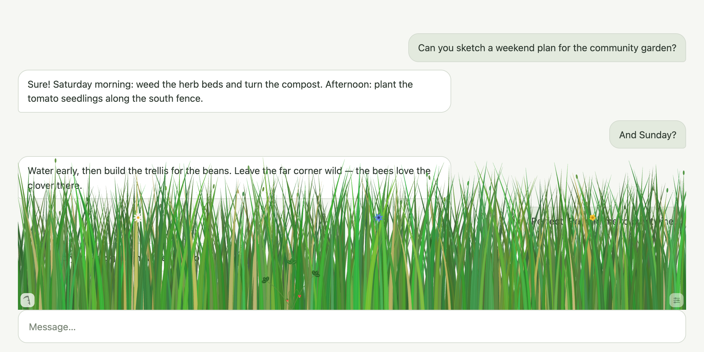
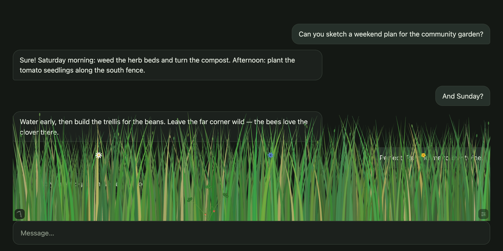
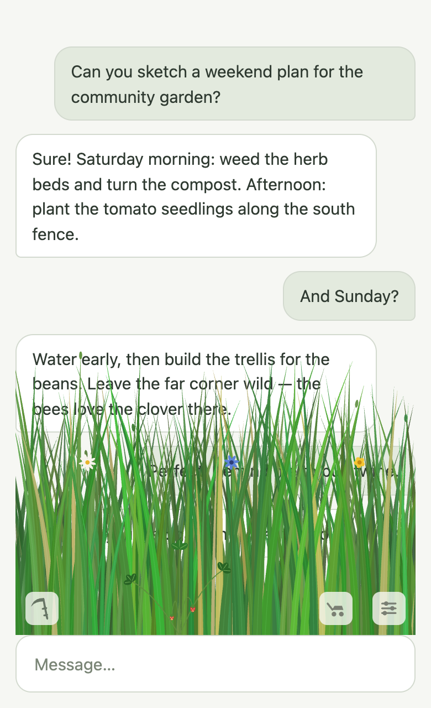
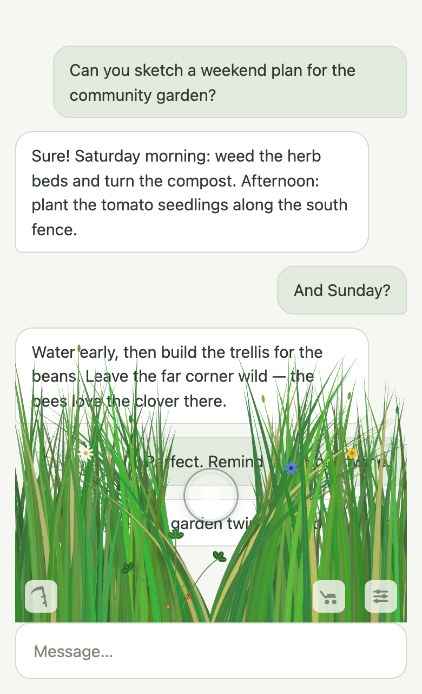
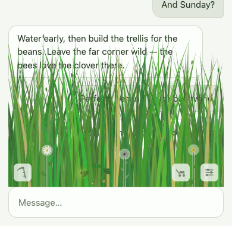

# Погладить траву

[English](README.md) · [Страница приложения](https://popkov.dev/apps/touch-grass/) · [Заявка в BB Market](https://github.com/get-bb/marketplace/pull/1034)

Пришло время погладить траву. Над полем ввода в каждом чате [BB](https://getbb.app) растёт свой луг. Проведи курсором по траве, чтобы пригнуть стебли. Коснись мерцающего огонька — светлячок улетит, а на его месте раскроется цветок.



## Как играть

- **Слева — коса.** Включи её и проведи мышью или пальцем по траве. Веди по верхушкам, чтобы подровнять луг, или у земли, чтобы оставить стерню. Чтобы срезать отдельный цветок, проведи косой через стебель или головку. Нажми кнопку ещё раз, чтобы убрать косу.
- **Поглаживание пальцем.** Убери косу и проведи по лугу вбок. Стебли цветов и трава заметно наклонятся за пальцем и распрямятся, когда его отпустишь. Свайп вверх или вниз по траве прокручивает чат.
- **Справа — газонокосилка.** Одно нажатие отправляет её через весь луг. Она срезает и траву, и цветы, и кустики земляники. В компактном и высоком режиме трава отрастает примерно за минуту.
- **Настройки здесь же.** Нажми кнопку с ползунками справа. Полоса перевернётся. Выбери размер и гостей — пчелу, бабочку, обоих или никого. Чтобы вернуться, нажми в ту же точку или используй Esc.
- **Цветы вырастают сами.** Первый появится в новом лугу примерно через 15 секунд. Чтобы сразу получить ещё один, нажми на светлячка или коротко проведи по нему. После покоса новое растение может появиться примерно через две минуты. В одном чате можно вырастить до 12 цветов. При следующем открытии на этом устройстве они останутся на месте.
- **Пчёлы прилетают к цветам, бабочки — и к простой траве.** Между цветами иногда вырастает низкий кустик земляники. У него тройчатые листья и красные ягоды на отдельных плодоножках. При включённом уменьшении движения гость сидит на месте, а косилка подстригает луг сразу.




При первом запуске включены **«Заросли»**. Зрелая трава поднимается поверх сообщений примерно на треть видимой области чата. Нажми на верхушки, чтобы примять их. Выстриги просвет косой, и через него снова можно будет нажимать ссылки. Газонокосилка расчищает всю полосу. В этом режиме газонокосилка, пчела и бабочка крупнее.

Сначала трава короткая. После полного покоса она снова вырастет за **40 минут реального времени**, даже если закрыть BB. У каждого чата на этом устройстве свои цветы, ягоды и прокосы. Размер, время роста и выбор гостей общие для всех чатов. В настройках луга видно, сколько осталось до полной высоты. Ползунком можно выбрать 20, 40 или 60 минут. Нажми **«Вырастить сейчас»**, чтобы сразу получить высокую траву в этом чате. После покоса снова пойдёт отсчёт.



## Что показывает луг

В компактном и высоком режиме новые сообщения и уточнения делают траву выше и гуще. Для старой истории BB учитываются начала ходов. После 5 шагов луг проходит 29% пути от ростков до зрелости, после 20 — 67%, после 50 — 100%. Если оставить чат открытым, высота сохранится. У каждого чата свой рисунок травинок. На компьютере это 38 пикселей в компактном режиме и 72 в высоком.

Высокая доля **входных токенов из кэша** делает зелень изумруднее. При низкой доле появляется больше соломенных стеблей. Если провайдер ещё не прислал данные, луг сохраняет обычную палитру.

Чем больше **недавних вызовов инструментов**, тем вероятнее встреча с пчелой у цветов. Плагин смотрит на 24 последних начатых действия. При 12 вызовах активность достигает максимума.



## Галерея зарослей

| На компьютере, светлая тема | Тёмная тема |
| --- | --- |
| [](docs/media/overgrown-desktop.png) | [](docs/media/overgrown-desktop-dark.png) |

| На телефоне | Если прижать пальцем |
| --- | --- |
| [](docs/media/overgrown-mobile.png) | [](docs/media/overgrown-press.png) |



## Установка и проверка

```sh
git clone https://github.com/ai-babai/bb-plugin-touch-grass.git
cd bb-plugin-touch-grass
npm ci
bb plugin build
bb plugin install .
```

Открой чат с полем ввода. Для проверки кода запусти `npm run quality`. [Методика проверки](docs/quality.md)

Исходный луг со светлячками сохранён в ветке [`archive/fireflies-v1`](https://github.com/ai-babai/bb-plugin-touch-grass/tree/archive/fireflies-v1) на коммите `388d564`. Для отката на чистой рабочей копии переключись на эту ветку, выполни `npm ci`, `bb plugin build` и `bb plugin reload touch-grass`. Чтобы вернуться к новой версии, повтори эти шаги с веткой `main`.
