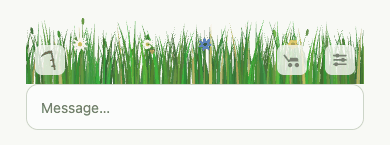

# Погладить траву

[English](README.md)

Над полем ввода в каждом чате [BB](https://getbb.app) растёт свой луг. Проведи курсором по траве, чтобы пригнуть стебли. Погладь мерцающий огонёк — светлячок улетит, а на его месте раскроется цветок.


## Как играть

- **Слева — коса.** Включи её и проведи мышью или пальцем по траве. Веди по верхушкам, чтобы подровнять луг, или у земли, чтобы оставить стерню. Диагональный взмах оставит склон. Нажми кнопку ещё раз, чтобы убрать косу.
- **Поглаживание пальцем.** Убери косу и проведи по лугу. Травинки наклонятся широкой волной, а когда отпустишь палец, постепенно распрямятся.
- **Справа — газонокосилка.** Одно нажатие отправляет её через весь луг. Цветы остаются, а трава отрастает примерно за минуту.
- **Настройки здесь же.** Нажми кнопку с ползунками справа. Полоса перевернётся. Выбери размер и гостей — пчелу, бабочку, обоих или никого. Чтобы вернуться, нажми в ту же точку или используй Esc.
- **Светлячки оставляют цветы.** Води курсором туда-сюда прямо над огоньком. В одном чате можно вырастить до 12 цветов. При следующем открытии на этом устройстве они останутся на месте.
- **Пчёлы прилетают к цветам, бабочки — и к простой траве.** Среди цветов встречается земляника. Когда пчела садится на её белый цветок, созревает красная ягода. Она остаётся в саду этого чата после покоса и перезапуска. При включённом уменьшении движения гость сидит на месте, а косилка подстригает луг сразу.




## Что показывает луг

Новые сообщения и уточнения делают траву выше и гуще. Для старой истории BB учитываются начала ходов. После 5 шагов луг проходит 29% пути от ростков до зрелости, после 20 — 67%, после 50 — 100%. Если оставить чат открытым, высота сохранится. У каждого чата свой рисунок травинок. На компьютере это 38 пикселей в компактном режиме и 72 в высоком.

Высокая доля **входных токенов из кэша** делает зелень изумруднее. При низкой доле появляется больше соломенных стеблей. Если провайдер ещё не прислал данные, луг сохраняет обычную палитру.

Чем больше **недавних вызовов инструментов**, тем вероятнее встреча с пчелой у цветов. Плагин смотрит на 24 последних начатых действия. При 12 вызовах активность достигает максимума.


## Установка и проверка

```sh
gh repo clone ai-babai/bb-plugin-touch-grass
cd bb-plugin-touch-grass
npm ci
bb plugin build
bb plugin install .
```

Открой чат с полем ввода. Для проверки кода запусти `npm run quality`. [Методика проверки](docs/quality.md)

Исходный луг со светлячками сохранён в ветке [`archive/fireflies-v1`](https://github.com/ai-babai/bb-plugin-touch-grass/tree/archive/fireflies-v1) на коммите `388d564`. Для отката на чистой рабочей копии переключись на эту ветку, выполни `npm ci`, `bb plugin build` и `bb plugin reload touch-grass`. Чтобы вернуться к новой версии, повтори эти шаги с веткой `main`.
